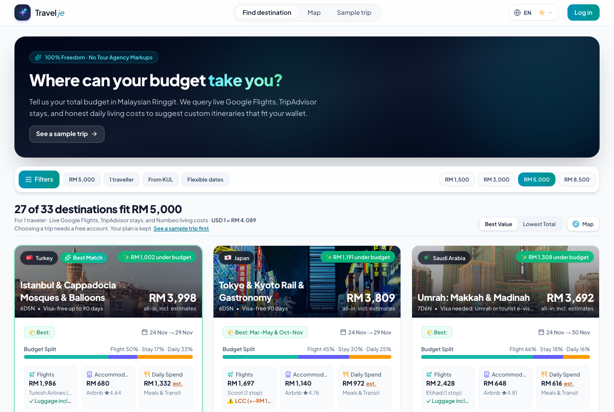
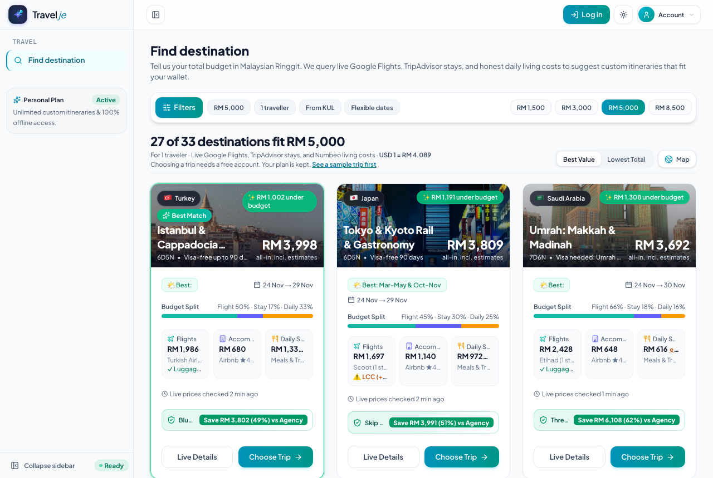
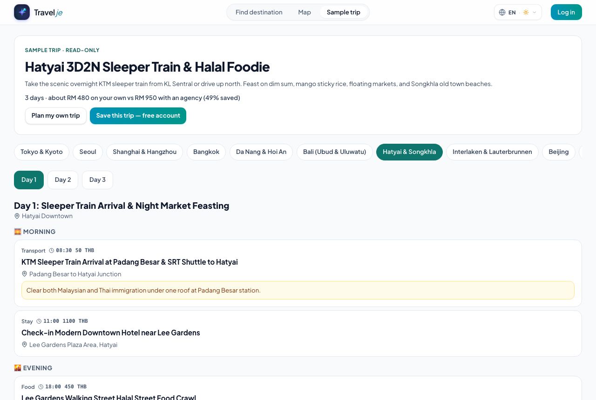

# Travelje

**Plan your own trip abroad on a Malaysian Ringgit budget: no tour package, no forced shopping stops, no agency markup.**

Travelje is a trip planner for independent travellers. Tell it your total budget in ringgit and where you fly from, and it shows which destinations fit, with live flight fares, real hotel prices and daily living costs. Pick one and you get a day-by-day plan you can edit, share, take offline and print.

## Screenshots

| | | |
|---|---|---|
|  |  |  |
| Where can your budget take you? | Every destination ranked against your budget | A read-only sample itinerary |

## What's inside

- **Budget planner**: live flight fares, hotel prices, exchange rates and weather, ranked by what fits your budget. Each trip shows how much you save against a typical agency package.
- **Day-by-day itinerary**: morning, afternoon, evening and night slots, booking references, tips, a route map and one-click multi-stop Google Maps directions.
- **Ready-made trips**: curated itineraries you can copy in one click and change.
- **Before you go**: plugs, voltage, transit passes, visa and arrival cards, cash vs card, emergency numbers and a readiness checklist.
- **Budget and expenses**: planned vs spent, multi-currency, split costs between travellers.
- **Works on a phone, offline**: trips are kept on the device and sync to your account when you are online.
- **Teams**: company workspaces with roles and trip approvals.
- **Two languages**: English and Bahasa Melayu.

## Architecture

See [`ARCHITECTURE.md`](./ARCHITECTURE.md) for how it is built.

## What this repository is

This is the **public** showcase of Travelje. The application code lives in a private repository. This repo holds only:

- ✅ This README, the architecture overview, the version table and screenshots.
- ❌ No source code, API keys, tokens, credentials, internal URLs or user data.
